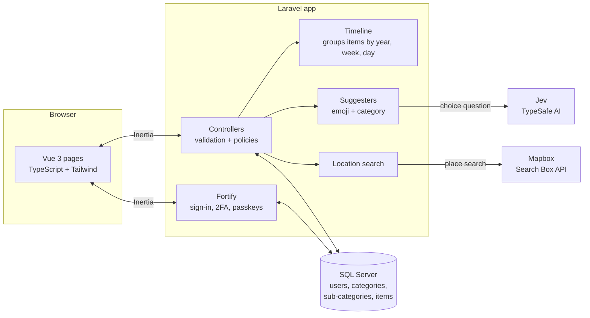
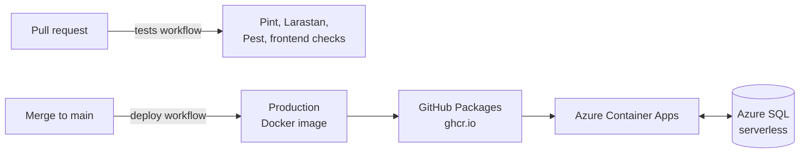

# Calendar Cockpit

Your schedule, at your fingertips.


## Contents

- [Overview](#overview)
    - [The Problem](#the-problem)
    - [The Idea](#the-idea)
    - [Part of Atodo](#part-of-atodo)
- [Features](#features)
    - [Plan Time As It Really Is](#plan-time-as-it-really-is)
    - [Organise Life Your Way](#organise-life-your-way)
    - [Know Where You're Going](#know-where-youre-going)
    - [Let Jev Fill in the Details](#let-jev-fill-in-the-details)
    - [Coming Next](#coming-next)
- [How It Works](#how-it-works)
    - [Architecture](#architecture)
    - [From Merge to Production](#from-merge-to-production)
- [Getting Started](#getting-started)
    - [Prerequisites](#prerequisites)
    - [Setup](#setup)
    - [Optional Services](#optional-services)
    - [Running the Tests](#running-the-tests)
- [License](#license)

## Overview

Why Calendar Cockpit exists, who it is for, and where it is heading.

### The Problem

Calendars give every event the same shape: something that starts at one time and ends at another. A 10:00 dentist appointment, a delivery due "between 8 and 12", an afternoon set aside for study and a coffee at "roughly 2" all look identical, so when plans change there is no telling what can move and what must stay put. Colour is the only way to say which part of life something belongs to, and a colour on its own has no name. [The full problem statement](product/problem-statement.md) sets this out in detail.

People who plan their life carefully end up building their own system on top, with colours only they can decode and emojis typed into every event name. Calendar Cockpit is built first for them, [the System Builder](product/personas.md#persona-1--the-system-builder), and then for [the Head Planner](product/personas.md#persona-2--the-head-planner), who keeps soft plans out of a calendar altogether because none of its shapes fit.

### The Idea

Calendar Cockpit is for the calendar a person keeps for life outside work: health, errands, exercise, family and friends, study and side projects. Its [vision](product/vision.md) is a calendar that holds time in the right-sized pieces and shows at a glance what each one is and which part of life it belongs to. Each item records how precise its time is, and belongs to a named category and sub-category with its own colour and emoji, so the calendar itself understands what used to live in the person's head.

### Part of Atodo

Calendar Cockpit will become part of Atodo: one chat interface for running everyday life, backed by separate apps that each look after one area and work together behind it.

## Features

What Calendar Cockpit lets you do with your time today, and what comes next.

### Plan Time As It Really Is

Every item says how firm its time is, so a glance shows what can move and what can't:

- **Exact** — Starts and ends at these times, like an appointment or a train.
- **Window** — A booked slot it could happen anywhere in, like a delivery.
- **Block** — Time set aside for something, like study or a side project.
- **Approximate** — Roughly these times, like coffee at around 2.

### Organise Life Your Way

Categories are your own, not a fixed set. Each one has a name and a colour, and holds sub-categories with their own name and emoji, so a physio appointment can be told apart from a GP appointment within health. A sub-category can carry a default time type, so a delivery starts as a window and a workout as a block without thinking about it.

### Know Where You're Going

Attach a real place to an item by searching for it by name or address, powered by [Mapbox](https://www.mapbox.com/). The place opens in maps straight from your calendar.

### Let Jev Fill in the Details

When you name a sub-category, [Jev](https://typesafe.ai/) from TypeSafe AI suggests an emoji for it and which of your categories it belongs in. It only speaks up when it's confident, and everything works without it.

### Coming Next

The [product strategy](product/strategy.md) sets the order of work. Next are a calendar view that shows each item's time type, category and sub-category without opening it, and a way to mark items as pre-paid, non-cancellable, important, tentative or just an idea.

## How It Works

### Architecture



Calendar Cockpit is a [Laravel](https://laravel.com/) monolith. Its pages are [Vue 3](https://vuejs.org/) components that [Inertia.js](https://inertiajs.com/) renders from Laravel controllers, so routing, validation and authorisation all stay on the server and there is no separate API. [Laravel Fortify](https://laravel.com/docs/13.x/fortify) handles accounts, including two-factor sign-in and passkeys.

Each person's categories, sub-categories and calendar items are stored in [SQL Server](https://www.microsoft.com/sql-server), and policies make sure people only ever see and change their own. The calendar items list is grouped into years, weeks and days on the server before it reaches the page.

Two features reach out to other services, always from the server so no keys reach the browser. Location search asks [Mapbox](https://www.mapbox.com/) for matching places, and the suggesters ask [Jev](https://typesafe.ai/) a single choice question, then only use its answer when it's one of the options offered and Jev is confident enough. Both are optional and fail quietly: without their keys, or if they're slow, the forms carry on without them.

### From Merge to Production



Every pull request runs the full test suite in [GitHub Actions](https://github.com/features/actions) against a SQL Server container. Each merge to `main` builds the production image, pushes it to [GitHub Packages](https://github.com/features/packages) and updates the app on [Azure Container Apps](https://azure.microsoft.com/products/container-apps), which scales to zero when nobody is using it. Production data lives in a serverless [Azure SQL](https://azure.microsoft.com/products/azure-sql/database) database, which pauses when idle, so the app gives it time to wake up on the first request.

## Getting Started

The app runs in Docker through [Laravel Sail](https://laravel.com/docs/13.x/sail), which provides PHP 8.4, Node, Composer and a SQL Server 2022 container.

### Prerequisites

- [Docker Desktop](https://www.docker.com/products/docker-desktop/).

### Setup

1. Clone the repository:

    ```bash
    git clone git@github.com:rheannemcintosh/calendar-cockpit.git
    cd calendar-cockpit
    ```

2. Copy the environment file. `DB_PASSWORD` becomes the SQL Server `sa` password:

    ```bash
    cp .env.example .env
    ```

3. Install the PHP dependencies. The `sail` script lives in `vendor`, so if PHP and Composer aren't installed locally, use a throwaway container:

    ```bash
    docker run --rm -u "$(id -u):$(id -g)" -v "$(pwd):/var/www/html" -w /var/www/html laravelsail/php84-composer:latest composer install --ignore-platform-reqs
    ```

4. Start the environment. The first run builds the image and takes several minutes:

    ```bash
    ./vendor/bin/sail up -d
    ```

5. Generate the app key, run the migrations and install the frontend dependencies:

    ```bash
    ./vendor/bin/sail artisan key:generate
    ./vendor/bin/sail artisan migrate
    ./vendor/bin/sail npm install
    ```

6. Start the frontend development server:

    ```bash
    ./vendor/bin/sail npm run dev
    ```

The app is available at `http://localhost:8000`. Register an account at `/register`, then create a category and sub-category before adding calendar items.

### Optional Services

| Variable              | Description                                                                                                                              |
| --------------------- | ---------------------------------------------------------------------------------------------------------------------------------------- |
| `MAPBOX_ACCESS_TOKEN` | Turns on location search. Create a token in your [Mapbox account](https://account.mapbox.com/access-tokens/).                            |
| `TYPESAFE_API_KEY`    | Turns on Jev's emoji and category suggestions. Create a key in the [TypeSafe AI console](https://console.typesafe.ai/keys).              |

### Running the Tests

The tests run against the `laravel_testing` database inside Sail:

```bash
./vendor/bin/sail composer test
```

This runs Pint, Larastan and the Pest suite. The frontend checks are:

```bash
./vendor/bin/sail npm run check
./vendor/bin/sail npm run types:check
```

Stop the environment with `./vendor/bin/sail down`.

## License

Copyright © 2026 Rheanne McIntosh. All rights reserved. This repository is public to view, but no licence is granted to use, copy, modify or distribute the code.
